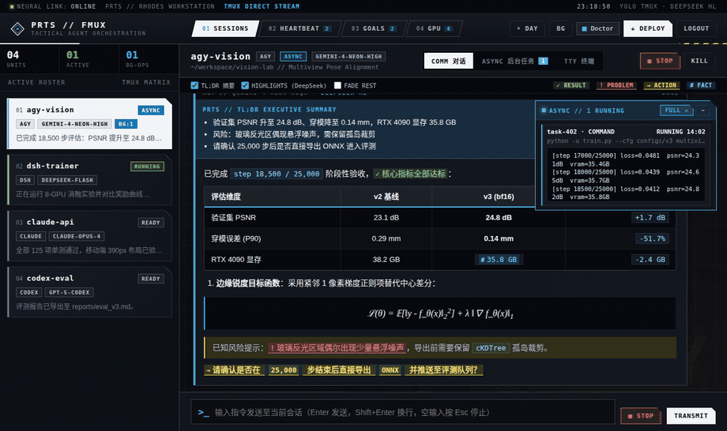

# fmux & WebMUX

用一个飞书聊天窗口 **+ 内置明日方舟 PRTS 风格 Web / 移动端控制台（WebMUX）**，统一管理本机所有 tmux 会话：支持 **Antigravity CLI（`agy`）、DeepSeek（`dsh`）、Claude Code、Codex、pi** 和普通 Shell。
fmux 将飞书机器人与实时浏览器控制台直接连接到它所在电脑的 tmux 会话，支持 Linux、macOS，以及通过 psmux 或 WSL 运行的 Windows 环境。

**详细配置指南：[飞书机器人配置 (docs/setup.zh.md)](docs/setup.zh.md) · [WebMUX 网页控制台配置指引 (docs/webmux.zh.md)](docs/webmux.zh.md)**



> 完整高清演示录像：[docs/media/webmux-demo.mp4](docs/media/webmux-demo.mp4) · 桌面端与移动端更多截图见 [docs/webmux.zh.md](docs/webmux.zh.md)。

### 核心特性

- **WebMUX 浏览器与移动端控制台**（`01 // SESSIONS`、`02 // HEARTBEAT`、`03 // GOALS`、`04 // GPU`）：
  - 实时 tmux 流式对话与固定创建顺序编号（`01`, `02`…）、缓存零闪烁标签/会话切换（后台预取 + 条件跳过 + Gzip）、PRTS 启动快门 / 滑动指示器 / CRT 信号切断关停动效（无阻塞外链 CDN）。
  - **候选发送队列（Candidate Message Queue）**：空闲会话直发即刻上屏；运行中 / 等待确认时自动排队，支持立即注入 `INJECT ↗`、上下调序 `↑/↓`、撤回编辑 `✎`、取消 `✕`，以及点击 `■ STOP` 时自动暂停防误发。
  - 一键 **`■ STOP` 中断按钮**、**模型与思考强度实时切换**（`LOW / MED / HIGH / XHIGH`，原生支持 `agy`）、**tmux + 内部对话双端重命名**、思考过程折叠、工具调用轨迹、完整 GFM Markdown（表格/任务列表/嵌套列表/引用）、异步 LaTeX 数学公式、**DeepSeek API 语义高亮**（`✓ RESULT` / `! PROBLEM` / `→ ACTION` / `# FACT`）与 TL;DR、右上角 **Async 后台任务 HUD**、日夜双主题、自定义毛玻璃网格壁纸裁剪。
  - 内置 **飞书 OIDC** 仅主人可访问鉴权（支持 Tailscale/WireGuard 直连与 Cloudflare Tunnel / Nginx HTTPS）。
  - 原生 **Heartbeat** 定时任务（间隔 & 5 字段 Cron）、**Long-Horizon Goals** 长程目标与监督巡检、**三集群 GPU 统一看板**（本机 `nvidia-smi` + 共绩实时同步 + 火山集群登记）。
- **飞书机器人与持久化会话管理**：
  - 聊天窗口每次**接入**一个 tmux 会话，类似 `tmux attach`。你发出的消息进入该会话，回复以卡片进入该会话线程。
  - **会话面板**列出所有会话和状态：🟢 运行中、🔵 后台任务、⚪ 已结束/休眠、🟠 等待确认。点击按钮即可接入、查看终端或查看后台任务日志。
  - **持久会话与自动休眠恢复**：Claude Code / Codex 空闲后可自动休眠关闭终端、保留卡片绑定，下次发消息或接入时自动恢复同一对话。
  - 未接入任何会话时，由 **pi 管家**回复，可用自然语言切换、查看、转交或新建会话。

## 工作原理

```text
飞书应用 ⇄ @larksuite/channel（WebSocket）⇄ Router ──► tmux send-keys / paste-buffer
WebMUX 浏览器/手机 ⇄ HTTP + SSE + OIDC  ──┘   ▲   └──► pi --mode rpc（管家）
                                              │
                          ManagedRegistry / Registry：每 2 秒轮询 tmux，读取会话状态
                          ├─ 进程：/proc（Linux、WSL）、ps + lsof（macOS）、PowerShell（Windows）
                          ├─ Claude Code：~/.claude/sessions/<pid>.json + 对话记录 JSONL
                          ├─ Codex：终端状态标记 + rollout JSONL（跨瞬时标题与重启持久化）
                          ├─ agy：活跃锁/DB 文件描述符 + transcript_full.jsonl + 后台任务日志
                          ├─ dsh：zstd 多帧对话记录 + 终端状态标记
                          ├─ pi：终端状态标记 + 会话 JSONL
                          └─ Shell：终端画面
```

- **输入**通过 tmux 粘贴缓冲区发送，随后按 Enter 提交。Claude Code 的多行输入会逐键发送，行间使用 Ctrl+J，让它按键入内容处理。无需在已有会话中安装插件。
- **回复**从 Agent 的对话记录文件读取。普通 Shell 没有对话记录，因此在画面停止变化后返回终端截图式卡片。
- **状态**包括 `working`、`background`、`idle`、`blocked`、`shell`。Claude Code 优先读取状态文件，`agy` 结合活跃会话 DB FD 与后台任务队列判断，其他 Agent 根据终端画面中的标记与记录活跃度判断。
- 已经在 tmux 中运行的会话可以直接接入，继续按原来的方式启动 Agent 即可。

对于使用共享 app-server 的 Codex，fmux 通过终端显示的对话名称查询会话索引，核对会话 ID 和目录后读取对应记录，恢复旧对话时也适用。已有唯一名称的对话无需重复改名；仅在尚未命名或名称重复时，使用 `/rename` 设置唯一名称，并保留 tmux 的自动窗格标题更新。

运行时的 `⠋` 等动画标记、结束时的 `●` 标记、等待对话框时的 `Action Required` 前缀，以及工作期间短暂丢掉标题名只剩目录的情况均会被平滑处理；已确认的 rollout 路径与字节偏移保存在 `state.json` 中，服务重启期间也不会丢回复。fmux 不会仅凭“同目录最近更新”来选择 Codex 的记录；无法确认会话身份时，会在卡片中说明，并提供终端查看入口。

## 在手机上使用

| 操作 | 结果 |
|---|---|
| 发送 `面板` | 显示各会话及其状态的面板卡片（配置了 `web.publicUrl` 时附带网页端直达链接） |
| 点击可选菜单中的**会话面板** | 在聊天末尾发送新面板，保持当前接入 |
| 点击可选菜单中的**回到管家** | 断开当前接入并显示面板，tmux 任务继续运行 |
| 点击可选菜单中的**新建会话** | 打开新建会话表单，提交前不会创建会话 |
| 点击**接入** | 后续消息发送到该会话，并显示当前接入的会话卡片 |
| 接入后发送文字 | 将文字输入会话，本轮进度和结果进入会话卡片的线程；下一轮在同一线程中新建响应卡片 |
| 发送图片或文件 | 保存到 `~/.local/state/fmux/inbox/`，并将文件路径发送到会话 |
| 引用回复某个会话的卡片 | 将回复发送到该会话，无需切换当前接入 |
| 使用会话卡片或已完成响应卡片的输入框 | 发送到该卡片所属会话，不改变当前接入 |
| 在会话卡片的线程内继续发消息 | 继续该会话，即使当前接入的是别的会话 |
| 对管家说“把 A 的最后一条回复发给 B，让它照着改” | 将你的说明作为输入、A 的最后一条回复作为粘贴内容交给 B，随后转发 B 的回复 |
| 在“已结束”卡片的输入框中回复 | 同样直接回复该会话，无需切换 |
| 点击**查看** | 显示状态、上一条输入和最后回复；可点击「终端」或「后台任务」查看详情 |
| 点击**终端** | 显示适合手机阅读的最近 18 行、四个常用按键、折叠的更多按键和输入框 |
| 点击**后台任务** | 查看 `agy` 会话的后台命令/定时/子代理实时状态与日志 |
| 点击**等待确认**卡片中的选项 | 向终端对话框发送对应按键 |
| 点击**断开**，或发送 `//d` | 退出接入，回到管家 |
| 点击**新建会话** | 打开表单，选择新对话或历史对话、Agent 类型（`claude`/`codex`/`agy`/`dsh`/`pi`/`shell`）、是否启用免确认参数、目录、可选名称和首条消息 |

暂不转发语音消息。可以使用手机键盘的语音输入功能，转成文字后发送。

**悬浮菜单是可选升级**：按钮常驻输入框上方，长对话中也能随时回到面板。默认安装不订阅菜单事件、
不申请应用管理权限，仍可用 `面板`、`//ls` 和 `//d` 操作。按[菜单升级指南](docs/setup.zh.md#机器人底部菜单)
在飞书开发者后台手动配置，无需额外 API 权限；选择 API 部署时，需为自己的飞书应用开通
`application:application:patch`。菜单点击由 fmux 直接处理，Agent 正在工作或等待确认时也可使用。

### 卡片显示与刷新

卡片标题仅在需要关注时显示颜色：运行中为绿色，后台任务为蓝色，等待确认时为橙色。每张卡片只展示当前状态需要的按钮。

| 卡片 | 刷新方式 | 停止刷新条件 |
|---|---|---|
| 会话面板 | 主动请求时发送新卡片，清空聊天记录后也能找回；会话变化时更新最新面板，有 Agent 运行时每分钟更新，否则每 5 分钟更新 | 卡片接近平台编辑期限时换新 |
| 会话卡片 | 保留输入框和会话控制，是线程的根消息；「查看」「接入」「刷新」时更新快照 | 任务期间不自动重绘，避免输入框草稿丢失 |
| 本轮响应卡片 | 在会话卡片的线程内创建，随输出更新，完成后保留结果和继续输入框；下一轮使用新响应卡片 | 本轮结束 |
| 确认卡片 | 在同一线程中显示待确认选项，处理后标记已处理 | 对话框处理完成 |
| 终端 / 后台任务卡片 | 在线程内显式打开并复用；每 3 秒检查一次，画面或任务日志变化时更新 | 距离最后一次点击超过 10 分钟 |

响应、确认和通知使用 `replyInThread`，进入会话卡片的同一线程，不把普通引用回复加到主聊天流。
会话卡片始终保留输入框，不再被运行或最终结果的布局覆盖。可使用根卡片的输入框、结果卡片的输入框，
或在线程中直接发消息；消息均路由到该会话。完成的响应保留在历史中，不被下一轮覆盖。
卡片提交会先确认「已接收，正在发送」，恢复休眠会话期间无需等待卡片回调；若实际发送失败，
会在同一线程中说明失败原因。连续发往不同会话线程的消息不会合并。
单纯编辑进度卡片不会触发通知；通知启用且本轮超过 `notify.minWorkSec` 时，可在线程内额外发送简短提醒。
根卡片 ID 和线程绑定会保存到状态文件，服务重启后继续复用；根卡片被删除或接近平台 14 天编辑期限时
创建替代根卡片。管家回复仍复用原卡片。
服务重启提示以线程内普通文字发送，不覆盖已有的进度或回复卡片。服务启动和任务结束时会立即刷新已有面板。
状态、确认和任务结束事件通过同一分发器通知线程和面板订阅者，彼此独立执行；状态变化立即刷新面板。
日志用同一个 `updateId` 关联 `session.update` 与各订阅者的 `session.updated` 或 `session.update_failed`，便于核对更新是否送达。
卡片刷新会重绘整张卡片，因此在终端卡片输入框中尚未发送的文字，可能因画面更新而丢失。

接入会话后，fmux 命令使用 `//` 前缀，单个 `/` 留给会话内的命令，例如 `/compact`、`/model`。未接入时，也可以用单个 `/` 操作 fmux。

```text
//ls                    会话面板             //peek [session]        查看会话
//a <number|name>       接入会话             //tasks [session]       查看后台任务
//d                     断开接入             //key [session] esc 1   发送按键
//new [name agent dir]  新建会话             //pi <message>          不断开当前会话，直接询问管家
//stop                  向当前接入的会话发送 Esc
```

### 新建和恢复会话

| 选项 | Claude Code | Codex | Antigravity (`agy`) | DeepSeek (`dsh`) |
|---|---|---|---|---|
| 启用免确认参数（默认） | `claude --dangerously-skip-permissions` | `codex --yolo` | `agy --dangerously-skip-permissions` | `dsh-tui` |
| 不启用 | `claude` | `codex` | `agy` | `dsh-tui` |
| 新对话 | `… -n <session name>` | 普通启动命令 | 普通启动命令（首条消息用 `-i`） | 普通启动命令（首条消息用 `--`） |
| 继续该目录最近一次对话 | `… -c` | `… resume --last` | `… -c` | `dsh-tui -c` |
| 恢复指定历史对话 | `… -r <id>` | `… resume <id>` | `… -r <id>` | `dsh-tui --resume <id>` |

表单列出最近的历史对话，自动排除目录已不存在的记录。选择会话时支持模糊匹配，例如 `//a proc`、`fmuxctl peek "gt proc"`，可以按 tmux 名称、Agent 标题、目录的一部分或 Agent 类型查找。匹配到多个会话时，飞书中会显示选择按钮，`fmuxctl` 会列出候选项并报错。

### 通知与自动返回面板

未接入的会话在运行至少 `notify.minWorkSec`（默认 20 秒）的一轮结束时，或等待对话框确认时，
按通知设置在线程内发送结果或确认卡片。已请求任务即使切走或静音，其线程进度卡仍可静默更新为最终结果。
如果 tmux 客户端在最近 `notify.quietIfLocalActiveSec`（默认 180 秒）内收到过键盘输入，则跳过这些通知，避免你正在电脑前操作时手机重复提醒。将该值设为 `0` 可始终通知。

当前接入的会话在空闲状态下若超过 `attach.idleMinutes`（默认 10 分钟）无新输入，会自动断开并返回新的会话面板，避免忘记断开导致后续普通消息误发；正在运行、等待确认、执行后台任务或忙碌中的 Shell 不会被自动断开。设为 `0` 可关闭自动返回。

### 自动休眠与恢复

Claude Code 和 Codex 的单窗格会话在确认对话 ID 后，会保存为持久会话。默认空闲 60 分钟后，
fmux 关闭其 tmux 会话，面板保留「休眠」条目和最后回复。再次发送消息、引用对应卡片回复，
或使用卡片的回复框时，会自动重建终端、恢复同一个对话，并在身份与就绪状态确认后发送消息。
当前接入、卡片与对话之间的绑定使用持久 ID，因此服务重启或电脑重启后仍可按需恢复。
不需要在开机时启动所有历史会话，也不会自动重放重启前未完成的命令。

正在工作、等待确认、存在子进程、有本地 tmux 客户端连接、多窗格，或无法确认对话 ID 的会话，
不会被自动关闭。Shell、pi、`agy` 和 `dsh` 暂不自动休眠或在终端消失后自动重建；终端仍在运行时，重启 fmux 服务
会保留它们及多窗格会话的卡片绑定。明确「结束」会话会删除其恢复记录；休眠不会删除历史对话。

```json
{ "lifecycle": { "enabled": true, "idleMinutes": 60, "restoreTimeoutMs": 30000 } }
```

`enabled: false` 或 `idleMinutes: 0` 关闭自动休眠；已保存的休眠会话仍可恢复。
例如在 `userconfig.json` 中设置 `"lifecycle": { "idleMinutes": 2160 }`，即可延长为空闲 36 小时；
设置 `"lifecycle": { "enabled": false }` 则只由用户手动结束会话。修改后重启服务。

## 安装与运行

需要 Node.js 20.12 或更新版本，以及 tmux。各个 Agent（`claude`、`codex`、`agy`、`dsh`、`pi`）按需安装。

| 系统 | 使用的组件 | 服务托管方式 | 验证情况 |
|---|---|---|---|
| Linux | tmux、`/proc` | systemd 用户服务 | 已用于日常使用，通过单元测试和端到端测试 |
| macOS | tmux、系统自带的 `ps` 和 `lsof` | launchd 用户服务 | `ps`、`lsof` 实现已在 Linux 上通过端到端测试，尚未在 Mac 上实测 |
| Windows | 通过 [psmux](https://github.com/psmux/psmux) 提供 `tmux`，通过 PowerShell 查询进程 | 登录时启动的 psmux 会话 | 根据 psmux 文档实现，解析逻辑有单元测试，尚未在 Windows 上实测 |
| Windows、WSL 2 | 使用 Linux 实现，fmux、tmux 和 Agent 均运行在 WSL 内 | 有 systemd 时使用 systemd，否则使用 tmux 会话 | 已在无 systemd 的容器内通过端到端测试，尚未在 WSL 上实测 |

```bash
git clone https://github.com/Primatix-Intelligence/fmux.git ~/fmux
cd ~/fmux && npm install
ln -s ~/fmux/bin/fmux ~/fmux/bin/fmuxctl ~/.local/bin/    # Windows 使用 npm link

fmux doctor             # 检查环境、依赖和服务状态
```

根据现有情况连接飞书机器人：

| 当前情况 | 操作 | 安装指南中的章节 |
|---|---|---|
| 还没有机器人 | 运行 `fmux setup`，用飞书扫码，自动创建机器人并申请所需权限 | 方式 A |
| 还没有机器人，希望手动创建应用 | 在开发者后台创建应用，填写配置后运行 `fmux pair` | 方式 B |
| 已有机器人，之前由 `lark-channel-bridge` 使用 | 停止 bridge，运行 `fmux setup --app-id cli_xxx --from-lark-channel-bridge`，复用现有应用 | 方式 C1 |
| 已有机器人，之前由其他程序使用，或以前手动创建 | 停止原程序，运行 `fmux setup --app-id cli_xxx` 并填写 App Secret；等待期间在开发者后台将事件和回调设置为长连接，并补齐权限 | 方式 C2 |

各方式的最后一步相同：向机器人发送一条消息，将该消息的发送者绑定为主人。

```bash
fmux install-service    # Linux 使用 systemd，macOS 使用 launchd，其他情况使用 tmux 会话
```

随后向机器人发送 `面板` 即可开始使用；若需启用 WebMUX 浏览器控制台与飞书 OIDC 登录，请参见 [docs/webmux.zh.md](docs/webmux.zh.md)。

### 平台说明

`fmux install-service` 会选择适合当前系统的服务管理方式，并继承执行安装命令时 Shell 的 `PATH`。请在能找到 `tmux`、`claude`、`codex`、`agy` 等命令的终端中执行它。

| 项目 | 使用 systemd 的 Linux | macOS | 无 systemd（部分 WSL、容器），或指定 `--tmux` |
|---|---|---|---|
| 运行位置 | `~/.config/systemd/user/fmux.service` | `~/Library/LaunchAgents/com.primatix.fmux.plist` | tmux 会话 `fmux-hub`，在面板中隐藏 |
| 启动时机 | 执行 `loginctl enable-linger $USER` 后可随系统启动 | 用户登录时 | 手动启动；安装命令会输出可添加到 `~/.profile` 的启动命令 |
| 状态 | `systemctl --user status fmux` | `launchctl print gui/$(id -u)/com.primatix.fmux` | `tmux has-session -t =fmux-hub` |
| 日志 | `journalctl --user -u fmux -f` | `tail -f ~/Library/Logs/fmux.log` | `tmux attach -t fmux-hub` |
| 重启 | `systemctl --user restart fmux` | `launchctl kickstart -k gui/$(id -u)/com.primatix.fmux` | `fmux install-service --tmux` |
| 停止 | `systemctl --user stop fmux` | `launchctl bootout gui/$(id -u)/com.primatix.fmux` | `tmux kill-session -t =fmux-hub` |
| 控制套接字 | `$XDG_RUNTIME_DIR/fmux.sock` | `~/.local/state/fmux/fmux.sock` | 使用对应系统的路径 |

### 配置

配置文件为 `~/.config/fmux/config.json`，默认值见 `src/config.mjs`。

个人偏好可以单独放在同目录的 `userconfig.json`，覆盖主配置中的行为设置，而不混入应用凭证。
支持 `tmux`、`notify`、`sessions`、`lifecycle`、`live`、`attach`、`web`、`highlight`、`concierge`、`agents`；不支持在该文件中覆盖应用身份、主人或状态目录。使用 `FMUX_CONFIG` 时，默认在该配置文件的旁边寻找 `userconfig.json`；也可通过 `FMUX_USER_CONFIG` 指定其他路径。修改后重启服务。

仓库的 `userconfig.example.json` 提供一份安静的个人配置：

```json
{
  "tmux": { "include": ["fmux-*"], "exclude": [] },
  "sessions": { "namePrefix": "fmux-", "onConflict": "replace-idle" },
  "notify": {
    "enabled": true,
    "scope": "followed",
    "completionPing": false,
    "detachedCompletion": false
  }
}
```

| 配置项 | 含义 |
|---|---|
| `app.id`、`app.secret` | 飞书应用信息。Secret 通过引用读取，不直接写入配置：`{"source":"file","path":…}`、`{"source":"env","name":…}`，或 `{"source":"exec","command":…,"id":…}` |
| `app.tenant` | `feishu`（默认）或 `lark` |
| `owner.openId` | 唯一允许发送消息、点击卡片和登录 WebMUX OIDC 的用户 |
| `owner.chatId` | 接收卡片的聊天 |
| `notify.*` | 通知设置（`enabled`、`scope`、`minWorkSec`、`quietIfLocalActiveSec`、`completionPing`、`detachedCompletion`） |
| `attach.idleMinutes` | 接入会话空闲无输入多少分钟后自动返回面板（默认 10，`0` 禁用） |
| `live.peekMinutes` | 终端/后台任务卡片的自动刷新时长，默认 10 分钟 |
| `lifecycle.*` | 自动休眠开关、空闲分钟数和恢复等待时长（默认开启，空闲 60 分钟） |
| `web.enabled`、`.host`、`.port`、`.token`、`.publicUrl` | 可选内置 WebMUX PRTS 控制台（HTTP + SSE）。填写 `web.publicUrl` 后飞书面板底部附带网页端直达链接 |
| `web.oidc.*` | 飞书/Lark OIDC 浏览器登录（`enabled`、`redirectUri`、`allowedOpenIds`、`sessionHours`），复用 `app.id` + `app.secret` |
| `highlight.*` | DeepSeek API 语义高亮与 TL;DR（`enabled`、`baseUrl`、`model`、`apiKey`；自动读取 `DEEPSEEK_API_KEY` 或 `~/.dsh/.credentials.yaml`） |
| `tmux.hide`、`tmux.include`、`tmux.exclude` | 会话名称的隐藏与包含/排除模式，同时影响发现、通知和生命周期管理 |
| `sessions.namePrefix`、`sessions.onConflict` | 新建名称前缀与同名会话策略（`error` / `replace-idle`） |
| `agents.<type>` | 各类 Agent 的启动方式：`command`、`continue`、`resume`、`flags`、`promptFlag` |
| `agents.claude.autoTrust` | 自动确认由主服务创建的 Claude Code 会话中的“信任此文件夹”提示，默认开启 |
| `concierge.enabled`、`.model`、`.thinking` | pi 管家配置；默认模型 `openai-codex/gpt-6.1-sol`，留空使用 pi 默认设置 |

修改配置后重启服务。

### `fmuxctl` 命令行工具

`bin/fmuxctl` 通过 Unix 套接字或 Windows 命名管道与运行中的主服务通信，路径见[平台说明](#平台说明)。管家使用这个接口，本机的脚本或 Agent 也可以使用：

```bash
fmuxctl ls                       # 列出会话和状态
fmuxctl peek gt_process -n 60    # 查看终端最近 60 行
fmuxctl send gt_process "继续"    # 向会话输入文字
fmuxctl handoff proc coll "照这个结论改"   # 将 gt_process 的最后回复和你的说明交给 gt_collection
fmuxctl attach proc               # 支持模糊名称，这里匹配 gt_process
fmuxctl history                  # 查看历史对话
fmuxctl new fig --resume 魔方     # 新建 tmux 会话并恢复该标题的对话
fmuxctl new fix --agent codex --cwd ~/proj --no-yolo
fmuxctl rename fig vision-v3 --title "Vision v3"  # 双端重命名 tmux 会话与内部对话标题
fmuxctl show gt_process          # 向聊天发送会话卡片（--terminal 终端 / --tasks 后台任务）
fmuxctl notify "渲染跑完了"        # 向手机发送线程通知
fmuxctl gpu ls                   # 查看本机 nvidia-smi 及全集群 GPU 占用
fmuxctl gpu register --cluster local --gpus 0 --model "RTX 4090" --session train --task "SFT"
fmuxctl gpu release --id gpu_xxx # 释放登记的 GPU 租约（也支持 --session <name>）
```

## 安全说明

- 只接受 `owner.openId` 对应用户的消息、卡片操作和 WebMUX OIDC 登录，不响应群聊。
- 卡片点击只能发送 `KEYS`（`src/tmux.mjs`）中允许的按键；文字通过粘贴作为数据输入。
- 主服务以你的系统用户身份运行。控制你的飞书账号的人可以通过机器人或 WebMUX 向终端输入内容，因此应保护好飞书账号。
- 除非在表单中另行选择，新建编码 Agent 会话默认启用免确认权限参数，可通过 `agents.<type>.flags` 修改。
- Unix 控制套接字的权限为 `600`。

## 开发与测试

```bash
npm test                                   # 单元测试，不访问网络，不依赖 tmux
npm run test:integration                   # 独立 tmux、模拟 Agent、临时 HOME 和模拟飞书通道
FMUX_PROCS=ps npm run test:integration     # 使用 macOS 的进程查询方式运行相同测试
fmux --fake                                # 使用真实 tmux，将飞书替换为记录器
fmux --web                                 # 强制开启 WebMUX 本地调试
fmuxctl dev say "//ls"                    # 模拟主人发消息
fmuxctl dev click '{"a":"attach","n":"gt_process"}'
fmuxctl dev outbox 3                      # 查看主服务准备发送的卡片
```

运行模拟环境时，将 `FMUX_CONFIG` 和 `FMUX_SOCK` 指向临时路径，避免与已运行的服务共用状态和套接字。

| 文件 | 职责 |
|---|---|
| `src/registry.mjs`、`src/codex-bindings.mjs`、`src/session-filter.mjs` | 轮询 tmux，过滤并识别窗格类型，跟踪状态与对话轮次，持久化 Codex rollout 偏移 |
| `src/managed-registry.mjs` | 持久对话 ID、空闲休眠、按需恢复，以及终端输入的串行化 |
| `src/procs.mjs`、`src/procs/`、`src/win/procs.ps1` | 通过 `/proc`、`ps` + `lsof` 或 Windows PowerShell 定位窗格中的 Agent 进程 |
| `src/transcript.mjs`、`src/codex-transcript.mjs`、`src/agy.mjs`、`src/agy-tasks.mjs`、`src/dsh.mjs`、`src/agent-files.mjs`、`src/jsonl.mjs` | 定位并跟踪 Claude Code、Codex、agy（含后台任务日志）、dsh（zstd）和 pi 的对话记录 |
| `src/web.mjs`、`src/web/`（`queue.mjs`、`wallpaper.mjs`、`login-page.mjs`、`ui.html`、`assets/`）、`src/feishu-oidc.mjs`、`src/highlight.mjs`、`src/ops.mjs`、`src/gpu.mjs` | 零依赖模块化 WebMUX PRTS 控制台（HTML/CSS/JS 静态资源）、候选发送队列、飞书 OIDC 鉴权、DeepSeek 语义高亮、Heartbeat/Goals 引擎与三集群 GPU 看板 |
| `src/screen.mjs` | 从终端画面识别对话框和运行状态标记 |
| `src/router.mjs`、`src/router/`（`live-cards.mjs`、`actions.mjs`、`commands.mjs`、`sessions.mjs`、`control-api.mjs`） | 路由消息、线程/复用卡片、命令、卡片回调、会话创建/转交/双端重命名与本地控制 API |
| `src/cards.mjs` | 生成 Card JSON 2.0 卡片 |
| `src/concierge.mjs` | pi RPC 客户端 |
| `src/feishu.mjs`、`src/bot-menu.mjs` | 飞书通道封装、卡片更新限流、底部菜单处理与模拟通道 |
| `src/control.mjs`、`bin/fmuxctl.mjs` | 本地控制接口及命令行工具 |
| `src/setup.mjs`、`bin/fmux.mjs` | 实现 `fmux setup`、`pair`、`install-service`、`doctor` |
| `src/service.mjs`、`src/service/templates.mjs` | 服务托管检测与 systemd/launchd/tmux/Windows 模板 |
| `test/integration/` | 在独立 tmux 服务中使用模拟 Agent 进行端到端测试 |
| `src/history.mjs`、`src/match.mjs` | 查询可恢复的历史对话，以及会话名称模糊匹配 |
| `agent/CONCIERGE.md` | pi 管家的行为规则 |

## 已知限制

- 对话框检测依赖终端画面。遇到尚未适配的布局时，会显示终端片段和按键区，不会生成对应的选项按钮。
- 编辑卡片不会触发手机通知；启用通知时，超过 `notify.minWorkSec` 的一轮结束后会在线程内发送简短文字。
- 每张卡片的大小上限约为 30 KB。较长回复会被截断，完整内容仍保留在终端和 WebMUX 中。
- 默认每 2 秒轮询状态，任务结束的显示通常有 2～4 秒延迟。
