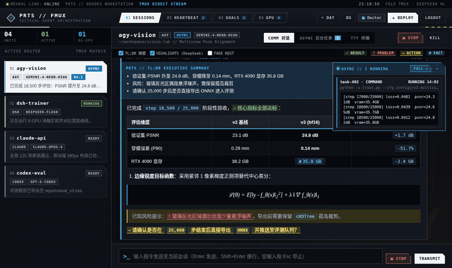
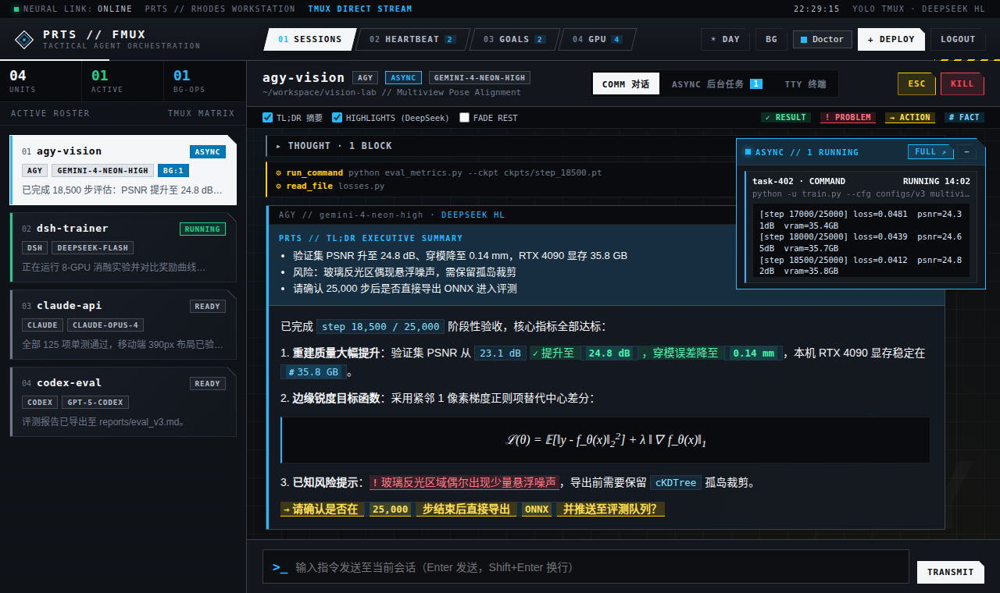
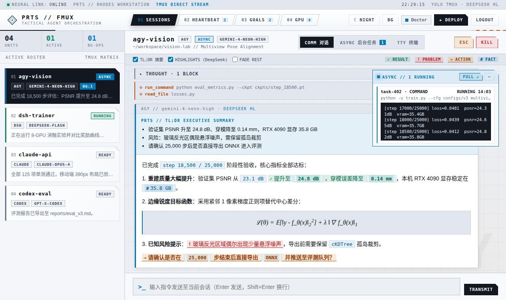
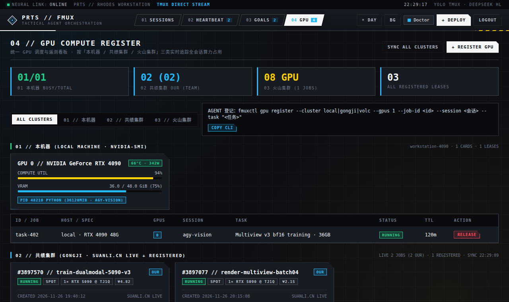
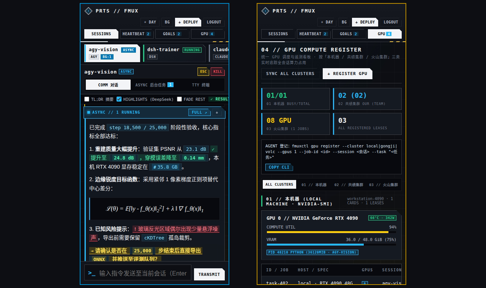

# WebMUX 浏览器控制台配置与使用指引

**WebMUX** 是内置在 `fmux` 中的零依赖浏览器端 / 手机端控制台（明日方舟 PRTS 战术终端风格），直接共享本地 `fmux` 守护进程的 tmux 会话状态、实时对话记录、定时调度与多集群 GPU 遥测。



> 完整高清演示视频见 [webmux-demo.mp4](media/webmux-demo.mp4)。

---

## 核心特性一览

| 模块 | 能力 |
|---|---|
| **`01 // SESSIONS`** | 同时管理 `agy`（Antigravity CLI）、`dsh`（DeepSeek Harness `dsh-tui`）、`claude`、`codex`、`pi` 与 `shell`；实时流式展示**思考过程（Thought）**、**工具调用轨迹**、**消息送达回执**、**LaTeX 数学公式**（KaTeX + 离线回退）与 **DeepSeek API 语义荧光高亮 / TL;DR**；右上角自动浮现运行中的 **Async 后台任务实时日志** |
| **`02 // HEARTBEAT`** | 定时任务调度中心（支持固定分钟间隔或 5 段 Cron），可向已有会话下发周期指令，或自动在 tmux 中拉起全权限（YOLO）Agent 执行 |
| **`03 // GOALS`** | 长期目标与监督中心：设定目标、验收标准、执行会话与**监督对话（Supervisor）**，按周期或一键向监督会话派发巡检纠偏指令 |
| **`04 // GPU`** | 三类集群统一 GPU 看板：**`01 本机器`**（`nvidia-smi` 实时利用率/显存/温度/功耗 + 进程反查所属会话）、**`02 共绩集群`**（自动同步在线任务）、**`03 火山集群`**（统一 CLI/HTTP 租约注册与释放） |
| **外观与移动端** | 日间 / 夜间模式一键切换、自定义**磨砂网格背景壁纸**（支持电脑/手机跨端同步）、`390px` 手机 Chrome / 飞书内置浏览器深度适配 |

| 夜间模式（Night） | 日间模式（Day） |
|---|---|
|  |  |

| 三集群 GPU 看板 | 手机端自适应（390px） |
|---|---|
|  |  |

---

## 1. 快速启用（本机访问）

如果你已经按 [setup.zh.md](setup.zh.md) 装好了 `fmux`，只需在 `~/.config/fmux/config.json` 中加上 `web` 配置即可启用 WebMUX：

```json
{
  "web": {
    "enabled": true,
    "host": "127.0.0.1",
    "port": 18790
  }
}
```

重启服务后在浏览器打开 `http://127.0.0.1:18790` 即可使用（也可以用 `fmux --web` 临时开启）：

```bash
# Linux systemd
systemctl --user restart fmux.service

# macOS launchd
launchctl kickstart -k gui/$(id -u)/com.primatix.fmux
```

---

## 2. 开启飞书 OIDC 单人授权（推荐，远程访问必配）

需要从**其他电脑或手机**访问时，建议开启飞书 OIDC 鉴权。它直接复用你在 `config.json` 中已配置的 `app.id` 和 `app.secret`，且默认**仅允许 `owner.openId` 本人登录**（其他任何飞书用户都会被拦截返回 `403 ACCESS DENIED`；如需额外放行成员，可填写 `web.oidc.allowedOpenIds`）。

### 第一步：修改 `~/.config/fmux/config.json`

```json
{
  "web": {
    "enabled": true,
    "host": "0.0.0.0",
    "port": 18790,
    "publicUrl": "http://<你的局域网或VPN IP>:18790",
    "oidc": {
      "enabled": true,
      "sessionHours": 24,
      "allowedOpenIds": []
    }
  }
}
```

- `publicUrl`：填写手机最常用的访问地址；设置后，飞书「会话面板」卡片底部会自动出现 **「打开网页端」** 入口链接。
- 如同时想保留口令访问（例如脚本调用 API），可额外设置 `"token": "自定义随机长串"`。

### 第二步：在飞书开发者后台配置回调白名单

打开 [飞书开发者后台](https://open.feishu.cn/app) → 进入你的 fmux 应用 → **安全设置** → **重定向 URL**，添加你要使用的回调地址（可同时添加多条）：

- 仅本机：`http://127.0.0.1:18790/auth/callback`
- Tailscale / WireGuard / 局域网直连：`http://<你的内网或VPN IP>:18790/auth/callback`
- 公网 HTTPS 域名反代：`https://fmux.example.com/auth/callback`

> WebMUX 在直连 HTTP 模式下会自动根据浏览器请求的 `Host` 生成对应的 `redirect_uri`，因此你可以同时从 Tailscale IP、WireGuard IP 和 `127.0.0.1` 登录而互不冲突；配置 `https://` 的 `publicUrl` 时则自动统一使用 HTTPS 回调。

### 第三步：重启服务并登录

```bash
systemctl --user restart fmux.service
```

打开网页点击 **`AUTHORIZE // 飞书 FEISHU OIDC`**，通过飞书确认一次即可保持 24 小时登录态。

---

## 3. 手机与外部网络接入方式

| 方案 | 适用场景 | 配置要点 |
|---|---|---|
| **方案 A：Tailscale / WireGuard 内网直连（最省事，零公网暴露）** | 电脑与手机已接入 Tailscale（含自建 Headscale）或公司 WireGuard VPN | `web.host` 设为 `"0.0.0.0"`，飞书回调白名单填入对应内网 IP 的 `/auth/callback`；手机 Chrome 或飞书内置浏览器直接打开 `http://<VPN_IP>:18790` |
| **方案 B：Cloudflare Tunnel 公网 HTTPS（无需本机公网 IPv4）** | 想在任意网络无 VPN 直开，或作为飞书工作台「网页应用」打开 | 本机运行 `cloudflared` 隧道把 `https://fmux.<你的域名>` 转发到 `http://127.0.0.1:18790`；`web.host` 保持 `"127.0.0.1"`，`web.publicUrl` 填 `"https://fmux.<你的域名>"` |
| **方案 C：自有公网 VPS + Nginx / Caddy 反代** | 已有带公网 IP 的服务器 | 在 VPS 上配 HTTPS 反代到本机（经 Tailscale/WireGuard），`web.publicUrl` 设为该 HTTPS 域名 |

---

## 4. 配置 DeepSeek 语义高亮与 TL;DR

WebMUX 内置了类似 Agentboard 的语义荧光高亮（`✓ RESULT`、`! PROBLEM`、`→ ACTION`、`# FACT`）与 3 行底部摘要（`TL;DR`），自动做原文反幻觉校验并缓存到 `~/.local/state/fmux/highlights.json`。

在 `~/.config/fmux/config.json` 中配置（可选）：

```json
{
  "highlight": {
    "enabled": true,
    "baseUrl": "https://api.deepseek.com/v1",
    "model": "deepseek-chat",
    "apiKey": ""
  }
}
```

密钥解析优先级：
1. `config.json` 中的 `highlight.apiKey`（建议留空，走环境变量更安全）
2. 环境变量 `DEEPSEEK_API_KEY`
3. 若本机装有 `dsh`，自动读取 `~/.dsh/.credentials.yaml` 中的 `DEEPSEEK_API_KEY`
4. 未配置密钥或离线时自动降级为本地零延迟启发式高亮，不影响正常使用。

---

## 5. 新建全权限会话（YOLO）与多 Agent 支持

通过 WebMUX 右上角 **`+ DEPLOY`** 或 `fmuxctl new` 新建会话时，默认都在 tmux 内以全权限（免确认）模式启动，方便远程无人值守运行：

| Agent | 默认启动命令 | 恢复历史对话 |
|---|---|---|
| `agy`（Antigravity CLI） | `agy --dangerously-skip-permissions` | 支持（`-c` / `-r <id>`） |
| `dsh`（DeepSeek `dsh-tui`） | `dsh-tui`（配合 `~/.dsh-tui/permission.json`） | 支持（`-c` / `--resume <id>`） |
| `claude`（Claude Code） | `claude --dangerously-skip-permissions -n {name}` | 支持（`-c` / `-r <id>`） |
| `codex`（Codex CLI） | `codex --yolo` | 支持（`resume --last` / `resume <id>`） |
| `pi` / `shell` | `pi` / 默认 Shell | — |

如需修改某个 Agent 的默认参数，在 `config.json` 中覆写 `agents.<type>.flags` 或 `command` 即可。

---

## 6. 统一 GPU 看板（`04 // GPU`）与 Agent 联动

任意终端、训练脚本或 AI Agent 会话都可以通过 `fmuxctl gpu` 或 HTTP API 向 WebMUX 登记和释放 GPU 占用，实现跨会话、跨集群的统一追踪：

```bash
# 查看全集群实时占用（本机 nvidia-smi + 在线集群任务 + 已登记租约）
fmuxctl gpu ls

# 登记本机 GPU
fmuxctl gpu register --cluster local --gpus 0 --model "RTX 4090" --session agy-vision --task "v3 训练"

# 登记共绩集群 Job（带 task_id，同 cluster+job-id 幂等更新）
fmuxctl gpu register --cluster gongji --gpus 1 --job-id 3897570 --host tj1q --model "RTX 5090" --session trainer --task "Spot 训练"

# 登记火山集群 MLP Job
fmuxctl gpu register --cluster volc --gpus 8 --job-id t-20261126-xxxx --host cn-beijing --model "A100-80G" --session trainer --task "8卡 SFT"

# 任务结束后释放
fmuxctl gpu release --job-id 3897570 --cluster gongji
```

- **共绩集群自动同步（可选）**：若本机配置了 `~/gongji/.env`（含 `SUANLI_TOKEN`）或环境变量 `SUANLI_TOKEN`，`fmux` 会自动每 30 秒只读拉取 `Pending/Running` 任务显示在 `02 // 共绩集群` 分区；可设置 `GONGJI_TASK_PREFIX` 标记属于自己的任务。
- **自定义背景壁纸**：点击顶栏 **`BG`** 上传任意 PNG/JPG/WebP/GIF（最大 12 MB），壁纸持久化保存在 `~/.local/state/fmux/wallpaper.bin` 并在电脑与手机间自动同步，支持实时调节透明度与磨砂模糊度，随时一键还原默认样式。
